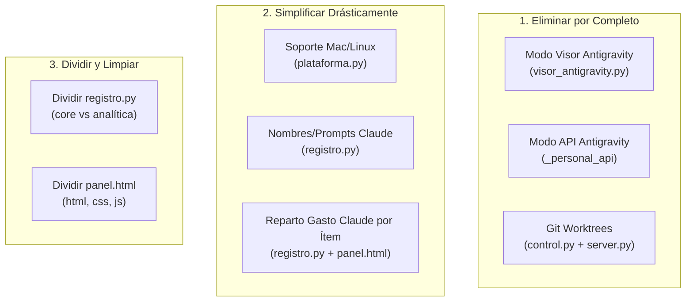

# Auditoría de Reducción y Simplificación del MCP Orchestrator

Esta auditoría de solo lectura analiza exhaustivamente los componentes del repositorio `D:\claude` con el objetivo de recortar complejidad, reducir el consumo innecesario de tokens/costos y acelerar los tiempos de delegación en los flujos de trabajo (OpenCode / Innti para `D:\workspaces` y Antigravity / `agy` para tareas personales).

---

## 1. Análisis Detallado por Archivo

### 1.1. `mcp_orchestrator/server.py`
- **Tamaño total:** 1335 líneas.
- **Descripción:** Punto de entrada del servidor FastMCP, define las herramientas expuestas a Claude y orquesta los procesos de ejecución (`opencode` y `agy` CLI/API).

| Función / Herramienta MCP | Qué hace (1 línea) | Líneas aprox. (inicio-fin, total) | ¿La usan las reglas o flujo actual? | Propuesta | Razón breve |
| :--- | :--- | :--- | :--- | :--- | :--- |
| `_env` | Lee variables de entorno limpiando espacios en blanco. | L40-L41 (2) | Sí (configuración inicial del servidor). | **Mantener** | Esencial y mínima. |
| `_live` | Escribe registros en vivo a `logs/en-vivo.log`. | L106-L113 (8) | Sí (trazabilidad de ejecuciones en tiempo real). | **Mantener** | Útil para monitorización sin impacto de latencia. |
| `_stamp`, `_slug`, `_tail` | Utilidades de formato de fechas, cadenas seguras y truncado. | L116-L129 (14) | Sí (generación de IDs y saneamiento de prompts/respuestas). | **Mantener** | Funciones auxiliares esenciales. |
| `_resolve_under`, `_inside` | Resolución y validación de pertenencia a directorios permitidos. | L130-L141 (12) | Sí (barrera de seguridad para enrutamiento). | **Mantener** | Crítica para la seguridad del enrutamiento. |
| `_resolve_personal` | Enruta subcarpetas relativas hacia universidad o personal. | L143-L150 (8) | Sí (enrutamiento de Antigravity). | **Mantener** | Mantiene la distinción de carpetas personales. |
| `_snapshot`, `_count_lines` | Detecta archivos modificados mediante mtimes y cuenta líneas. | L152-L179 (28) | Sí (informe post-delegación de cambios en disco). | **Mantener** | Informa con precisión el resultado a Claude. |
| `_strip_jsonc` | Remueve comentarios y comas sobrantes de JSONC. | L181-L185 (5) | Sí (parseo de configuración de OpenCode). | **Mantener** | Pequeña y necesaria para leer `opencode.jsonc`. |
| `_opencode_cmd`, `OPENCODE_ENV`, `_oc_auth` | Resuelve binario, variables de entorno y credenciales para OpenCode. | L187-L202 (16) | Sí (ejecución de OpenCode). | **Mantener** | Indispensable para el flujo de trabajo corporativo. |
| `_open_console` | Abre ventana externa con la terminal del sistema. | L203-L209 (7) | Parcial (solo si `MOSTRAR_CONSOLA=1` y no se usa la terminal interna). | **Simplificar** | Remover ramas multiplataforma delegando solo a `wt.exe`. |
| `_ensure_opencode_server` | Inicia el daemon `opencode serve` en segundo plano si está inactivo. | L211-L230 (20) | Sí (manejo de servidor persistente para TUI). | **Mantener** | Evita arranques lentos y fallos de conexión. |
| `_create_session` | Crea una sesión en el servidor OpenCode mediante API HTTP. | L232-L241 (10) | Sí (vinculación a sesiones de trabajo). | **Mantener** | Requerida para conservar contexto en rondas. |
| `_run` | Ejecuta subprocesos asíncronos canalizando la salida a logs. | L243-L271 (29) | Sí (ejecución de comandos CLI). | **Mantener** | Motor asíncrono básico. |
| `listar_modelos_innti` (MCP) | Consulta modelos disponibles en archivo local, CLI o endpoint LiteLLM. | L275-L317 (43) | Parcial (consulta previa para elegir modelo). | **Simplificar** | Leer solo de `opencode.jsonc`; quitar fallback de red LiteLLM si ralentiza. |
| `_git_checkpoint` | Genera punto de retorno git (commit/cambios pendientes) en repos directos. | L319-L333 (15) | Sí (cuando no se usa worktree). | **Mantener** | Esencial si se retiran los worktrees para permitir rollback. |
| `_session_tokens` | Extrae tokens consumidos vía API HTTP del servidor OpenCode. | L335-L354 (20) | Sí (cálculo de costos de Innti). | **Mantener** | Requerido para la contabilidad de costos. |
| `_work_cwd` | Obtiene el directorio base de trabajo para una ruta o archivo. | L356-L365 (10) | Sí (preparación del entorno de ejecución). | **Mantener** | Necesaria para evitar errores con rutas de archivo. |
| `_aislar` | Crea un worktree git temporal para aislar cambios del repo principal. | L367-L382 (16) | Parcial (candidato principal a eliminación). | **Quitar** | El usuario prefiere trabajar directo sobre el repo para evitar demoras. |
| `preparar_vista_opencode` (MCP) | Paso 1 en Claude Code: crea sesión OpenCode y devuelve comando de terminal. | L384-L415 (32) | Sí (flujo de terminal interna en Claude Code). | **Simplificar** | Quitar lógica de aislamiento en worktrees. |
| `ejecutar_trabajo_opencode_innti` (MCP) | Delega tareas corporativas a OpenCode con modelos Innti. | L417-L553 (137) | Sí (núcleo del flujo de trabajo `D:\workspaces`). | **Simplificar** | Eliminar parámetros y ramas de aislamiento de worktree. |
| `ejecutar_personal_antigravity` (MCP) | Delega tareas personales a Antigravity (apertura externa o API). | L555-L621 (67) | Parcial (el flujo actual prefiere `preparar_tarea_antigravity`). | **Simplificar** | Quitar modo API y modo visor propio; dejar solo ejecución vía CLI `agy`. |
| `_cierre_personal` | Computa tokens/costos de Antigravity y actualiza el checklist. | L623-L646 (24) | Sí (cierre de tareas personales). | **Mantener** | Vital para registrar aprendizaje y métricas. |
| `_emit` | Escribe eventos JSON en archivo para el visor propio. | L648-L651 (4) | No (usado exclusivamente por `visor_antigravity.py`). | **Quitar** | Desaparece al suprimir el modo visor propio. |
| `_agy_confiar` | Agrega carpetas a `trustedWorkspaces` en `settings.json` de agy. | L656-L675 (20) | Sí (evita bloqueos interactivos de confirmación). | **Mantener** | Muy conveniente para evitar pausas interactivas. |
| `_agy_cmd` | Resuelve la ruta del ejecutable `agy`. | L678-L682 (5) | Sí (ejecución de CLI Antigravity). | **Mantener** | Esencial. |
| `_agy_prepare` | Arma prompt adaptado y estructura de tarea para Antigravity. | L690-L714 (25) | Sí (flujo Antigravity). | **Mantener** | Estandariza la orden y salida esperada. |
| `_agy_wait` | Sondea la finalización de Antigravity leyendo el archivo `.resultado`. | L716-L771 (56) | Sí (espera pasiva por archivos). | **Mantener** | Robusto y no interactivo. |
| `_agy_corte` | Gestiona caídas de cuota/límite o desconexión en agy. | L773-L795 (23) | Sí (mecanismo de fallback automático de modelos). | **Mantener** | Evita bloqueos cuando se satura un modelo. |
| `_agy_conversacion` | Recupera el ID de conversación reciente de agy desde cache local. | L797-L806 (10) | Sí (reutilización de contexto en rondas). | **Mantener** | Vital para conservar contexto. |
| `_agy_tokens`, `_agy_pasos`, `_agy_fallo` | Extrae métricas de tokens y errores analizando el transcript jsonl de agy. | L808-L878 (71) | Sí (detección de límites de modelo y cómputo de tokens). | **Mantener** | Permite auditoría de consumo sin cobro de API. |
| `_siguiente_modelo`, `_conv_valida` | Cadena de fallback de modelos agy y validación sintáctica de UUID. | L880-L890 (11) | Sí (gestión de cuotas en Antigravity). | **Mantener** | Mantiene la resiliencia de agy. |
| `_personal_agy_tui` | Ejecuta `agy -i` en ventana externa con la TUI interactiva oficial. | L892-L924 (33) | Parcial (solo si se delega con ventana externa). | **Mantener** | Respaldo para ejecución fuera de terminal interna. |
| `preparar_tarea_antigravity` (MCP) | Paso 1 para ejecutar Antigravity en el panel de terminal de Claude. | L927-L977 (51) | Sí (flujo estándar actual en Claude Code). | **Mantener** | Núcleo del flujo personal. |
| `esperar_resultado_antigravity` (MCP) | Paso 2: espera y procesa el resultado devuelto por agy. | L979-L994 (16) | Sí (flujo estándar actual en Claude Code). | **Mantener** | Núcleo del flujo personal. |
| `_step_label` | Extrae parámetros legibles de eventos de herramientas para el visor. | L996-L1002 (7) | No (solo usada por `_personal_agy` con visor). | **Quitar** | Prescindible sin el visor propio. |
| `_personal_agy` | Ejecuta agy capturando stream-json para el visor propio. | L1004-L1123 (120) | No / Marginal (orientado al modo visor). | **Quitar** | Redundante con la TUI oficial y la terminal de Claude. |
| `_personal_api` | Respaldo por llamadas directas OpenAI-compatible a la API de Gemini. | L1125-L1190 (66) | No (el usuario opera con cuenta Pro en agy CLI). | **Quitar** | Candidato claro: genera costo de API y no tiene herramientas completas. |
| `ver_configuracion` (MCP) | Informa rutas, modelos y estado del entorno. | L1194-L1205 (12) | Sí (diagnóstico y arranque de sesión). | **Mantener** | Informativa y ligera. |
| `verificar_proyecto` (MCP) | Ejecuta tests/lint detectados o configurados en el proyecto. | L1209-L1222 (14) | Sí (control de calidad post-delegación). | **Mantener** | Clave para verificar entregables antes de cerrar. |
| `configurar_verificacion` (MCP) | Guarda comandos específicos de prueba/build por proyecto. | L1224-L1229 (6) | Sí (soporte de verificación personalizada). | **Mantener** | Ligera y útil. |
| `integrar_trabajo` (MCP) | Aplica o descarta un worktree git temporal. | L1231-L1236 (6) | Parcial (asociada a worktrees). | **Quitar** | Desaparece si se eliminan los worktrees. |
| `listar_trabajos_aislados` (MCP) | Lista worktrees pendientes. | L1238-L1242 (5) | Parcial (asociada a worktrees). | **Quitar** | Desaparece si se eliminan los worktrees. |
| `estado_presupuesto` (MCP) | Consulta el estado del gasto frente a límites diario/mensual. | L1244-L1248 (5) | Sí (freno de costos en Innti). | **Mantener** | Vital para no exceder consumo corporativo. |
| Herramientas Checklist (`iniciar_pedido`, `actualizar_item`, `agregar_items`, `cerrar_pedido`, `ver_pedido`, `listar_pedidos`) | Gestión completa del checklist de trabajo en disco. | L1252-L1292 (41) | Sí (núcleo del flujo operativo del usuario). | **Mantener** | Estructura indispensable de orden y seguimiento. |
| `resumen_costos` (MCP) | Muestra resumen consolidado de costos de los últimos días. | L1294-L1298 (5) | Sí (control financiero). | **Mantener** | Rápida y de gran utilidad. |
| `registrar_aprendizaje`, `consultar_aprendizajes` (MCP) | Registra y recupera lecciones aprendidas por proyecto y modelo. | L1300-L1311 (12) | Sí (mejora continua en selección de modelos). | **Mantener** | Clave en las instrucciones del orquestador. |
| `exportar_panel` (MCP) | Genera payload JSON para sincronizar el panel HTML de Artifacts. | L1314-L1332 (19) | Sí (sincronización del panel). | **Simplificar** | Reducir volumen generado eliminando datos no esenciales. |

---

### 1.2. `mcp_orchestrator/registro.py`
- **Tamaño total:** 1105 líneas.
- **Descripción:** Almacenamiento y cálculo de costos, gestión de checklists (pedidos), parseo de transcripts de Claude (`~/.claude/projects`) y agregación de datos para el panel web.

| Función / Lógica | Qué hace (1 línea) | Líneas aprox. (inicio-fin, total) | ¿La usan las reglas o flujo actual? | Propuesta | Razón breve |
| :--- | :--- | :--- | :--- | :--- | :--- |
| `_precios`, `_precio_vigente`, `costo_innti` | Carga tarifas y calcula costo en USD para Innti/Gemini/Claude. | L46-L74 (29) | Sí (base de costos de todo el orquestador). | **Mantener** | Núcleo de cálculo económico. |
| `registrar_costo`, `resumen_costos` | Guarda consumos en `costos.jsonl` y genera resúmenes en texto. | L76-L125 (50) | Sí (registro y reporte de gasto). | **Mantener** | Fundamental para trazabilidad. |
| Funciones de Pedidos (`_path`, `_load`, `_render`, `_save`, `separar_ruta`, `iniciar_pedido`, `agregar_items`, `actualizar_item`, `cerrar_pedido`, `ver_pedido`, `listar_pedidos`) | CRUD y renderizado markdown de pedidos/checklists en disco. | L129-L268 (140) | Sí (seguimiento de entregables e ítems). | **Mantener** | Núcleo funcional del orquestador. |
| `item_automatico`, `vincular_delegacion` | Asigna delegaciones huérfanas a pedidos existentes o nuevos. | L270-L307 (38) | Sí (vinculación entre ejecución y checklist). | **Mantener** | Evita que las tareas se ejecuten sin trazabilidad. |
| `costos_data`, `costos_diarios`, `consumo_por_item` | Agregación de costos por día y por ítem para estadísticas. | L309-L409 (101) | Sí (alimentación de métricas de panel). | **Mantener** | Cálculos directos y útiles. |
| `_ventanas_items`, `_items_de` | Algoritmo heurístico para prorratear el tiempo/consumo de Claude entre ítems. | L411-L458 (48) | Parcial (genera sobrecarga en cada exportación de panel). | **Simplificar / Quitar** | Complejo, frágil e impreciso; Claude no necesita imputarse por ítem. |
| `_mensajes_claude` | Escanea y desduplica transcripts de Claude Code buscando tokens de sesión. | L465-L550 (86) | Parcial (solo para el panel de Artifacts). | **Simplificar / Mover** | Muy pesado en I/O. Debe aislarse en un submódulo de analítica. |
| `_prompts_claude`, `_huella`, `nombres_tareas`, `_titulos_claude` | Infiere títulos de tareas analizando prompts y llamadas a herramientas en transcripts. | L552-L693 (142) | No esencial (solo para cosmética de sesiones en el panel). | **Quitar** | Consume CPU e I/O innecesariamente; basta con el ID o título nativo de sesión. |
| `sesiones_claude`, `_pedidos_por_sesion`, `costo_claude`, `consumo_claude`, `_pedido_de` | Vincula sesiones de Claude Code con pedidos específicos y calcula costo API de Claude. | L695-L788 (94) | Parcial (orientado a métricas del panel). | **Simplificar** | Cálculo agregado simple sin rastreo línea a línea de subsesiones. |
| `_sueltas` | Asocia delegaciones sin pedido al último pedido del proyecto. | L790-L831 (42) | Sí (cuadre de costos huérfanos). | **Mantener** | Garantiza que todo gasto figure en algún pedido. |
| `datos_panel` | Función masiva que consolida pedidos, sesiones, Claude y costos para el JSON del panel. | L833-L1057 (225) | Sí (usado por `exportar_panel`). | **Simplificar / Modularizar** | Excesivamente largo (225 líneas) y lento por escaneos de Claude; debe separarse. |
| `proyecto_de`, `registrar_aprendizaje`, `consultar_aprendizajes` | Gestión de bitácora de aprendizajes en `aprendizajes.jsonl`. | L1061-L1105 (45) | Sí (mejora de selección de modelos). | **Mantener** | Ligero, modular e independiente. |

---

### 1.3. `mcp_orchestrator/control.py`
- **Tamaño total:** 277 líneas.
- **Descripción:** Lógica de verificación automatizada de proyectos, manipulación de git worktrees y control de presupuesto para Innti.

| Función / Bloque | Qué hace (1 línea) | Líneas aprox. (inicio-fin, total) | ¿La usan las reglas o flujo actual? | Propuesta | Razón breve |
| :--- | :--- | :--- | :--- | :--- | :--- |
| `_now`, `_git` | Auxiliar de fecha y wrapper seguro de `git` con `stdin=DEVNULL`. | L21-L30 (10) | Sí (ejecución segura de comandos git). | **Mantener** | Evita bloqueos de stdio en el servidor MCP. |
| `_leer_verif`, `guardar_verificacion` | Lee y escribe reglas de verificación en `verificacion.json`. | L34-L50 (17) | Sí (configuración de tests por proyecto). | **Mantener** | Sencillo y necesario. |
| `detectar_comandos`, `comandos_para` | Detección heurística de suites de build/test (Maven, Gradle, npm, Pytest, Go). | L52-L104 (53) | Sí (verificación sin configuración manual previa). | **Mantener** | Muy útil para automatizar la calidad. |
| `verificar` | Ejecuta las suites de prueba en subproceso y reporta VERDE/ROJO con extractos. | L106-L138 (33) | Sí (herramienta `verificar_proyecto`). | **Mantener** | Pieza central de control de calidad. |
| `_leer_wt`, `_guardar_wt` | Persistencia del registro de worktrees en `worktrees.json`. | L142-L152 (11) | Parcial (exclusivo de worktrees). | **Quitar** | Innecesario si se elimina el aislamiento por worktrees. |
| `repo_root` | Detecta la raíz del repositorio Git con `rev-parse`. | L154-L157 (4) | Sí (tanto para checkpoints como para worktrees). | **Mantener** | Útil para `_git_checkpoint`. |
| `worktree_info`, `crear_worktree`, `confirmar_cambios`, `integrar`, `listar_worktrees` | Ciclo de vida de aislamiento: creación de rama `orq/`, squash merge y borrado. | L159-L235 (77) | Parcial (aislamiento de trabajo). | **Quitar** | El usuario prefiere trabajar directo en el repo para agilizar las delegaciones. |
| `_limite`, `gasto`, `estado_presupuesto` | Control y freno automático de delegaciones al alcanzar presupuesto en USD. | L239-L277 (39) | Sí (seguridad de gasto en Innti). | **Mantener** | Vital para evitar sorpresas en facturación corporativa. |

---

### 1.4. `mcp_orchestrator/plataforma.py`
- **Tamaño total:** 119 líneas.
- **Descripción:** Abstracciones del sistema operativo: detección de plataforma, rutas predeterminadas, apertura de emuladores de terminal y sanitizado de comandos para shells (PowerShell vs zsh/bash).

| Función / Bloque | Qué hace (1 línea) | Líneas aprox. (inicio-fin, total) | ¿La usan las reglas o flujo actual? | Propuesta | Razón breve |
| :--- | :--- | :--- | :--- | :--- | :--- |
| `IS_WINDOWS`, `IS_MAC`, `REPO_ROOT` | Detección de plataforma y resolución de directorio raíz. | L19-L22 (4) | Sí (configuración global). | **Simplificar** | Fijar o asumir entorno Windows si no se requiere portabilidad. |
| `exe`, `default_dir`, `default_opencode_config`, `default_agy` | Rutas por omisión según el SO para binarios y configs. | L25-L45 (21) | Sí (detección de ejecutables). | **Simplificar** | Dejar solo rutas de Windows (`.exe`, `%USERPROFILE%`). |
| `open_terminal`, `_env_prefix`, `_applescript_string` | Abre nueva terminal externa mediante Windows Terminal, AppleScript o emuladores Linux. | L49-L84 (36) | Parcial (solo Windows es usado por el usuario). | **Simplificar** | Eliminar ramas completas de AppleScript (macOS) y Linux X11/Wayland. |
| `_ps`, `quote_path` | Entrecomillado seguro para PowerShell o shlex. | L87-L93 (7) | Sí (formación de líneas de comando). | **Simplificar** | Mantener solo entrecomillado para PowerShell. |
| `safe_prompt`, `quote_prompt` | Normaliza a ASCII y limpia caracteres conflictivos para terminales de Claude. | L95-L112 (18) | Sí (obligatorio para `run_in_terminal` en Claude Code). | **Mantener** | Crucial para evitar fallos de escape en terminal. |
| `run_line` | Construye la sentencia unificada `Set-Location ...; & ...` para el shell. | L114-L119 (6) | Sí (usado en `preparar_vista_opencode` y `preparar_tarea_antigravity`). | **Simplificar** | Dejar sintaxis pura de PowerShell. |

---

### 1.5. `mcp_orchestrator/visor_antigravity.py`
- **Tamaño total:** 307 líneas.
- **Descripción:** Aplicación de terminal Rich con interfaz visual dedicada (degradados, animaciones, spinner y paneles) para monitorizar eventos stream-json de `agy` o la API de Gemini.

| Componente | Qué hace (1 línea) | Líneas aprox. (inicio-fin, total) | ¿La usan las reglas o flujo actual? | Propuesta | Razón breve |
| :--- | :--- | :--- | :--- | :--- | :--- |
| Configuración Rich, temas y logo ASCII | Define paleta de colores de Gemini, fuentes y arte ASCII del logo Antigravity. | L1-L79 (79) | No (solo usada por el visor propio). | **Quitar** | Innecesaria al eliminar el visor propio. |
| `State`, `feed` | Lee `.events` en bucle y reconstruye el árbol de pasos y texto del agente. | L100-L151 (52) | No (reimplementa lo que ya muestra la TUI oficial). | **Quitar** | Consume recursos y duplica funcionalidad nativa de `agy`. |
| Componentes de Interfaz (`header`, `task_card`, `steps_panel`, `body_panel`, `footer`) | Paneles renderizados en vivo para pasos, consumo de tokens y markdown. | L163-L250 (88) | No. | **Quitar** | Mantenimiento innecesario. |
| Bucle de renderizado `Live` y transcripción final | Bucle principal a 12 FPS y espera interactiva de pulsación de tecla Enter. | L252-L307 (56) | No. | **Quitar** | El flujo estándar actual usa la terminal interna de Claude (`preparar_tarea_antigravity`) o `agy -i`. |

---

### 1.6. `config/panel.html`
- **Tamaño total:** 1188 líneas.
- **Descripción:** Aplicación SPA embebida como artefacto interactivo en Claude. Visualiza KPIs, gráficas SVG de costos diarios, tabla comparativa de sesiones y detalle de pedidos.

| Módulo / Sección | Qué hace (1 línea) | Líneas aprox. (inicio-fin, total) | ¿La usan las reglas o flujo actual? | Propuesta | Razón breve |
| :--- | :--- | :--- | :--- | :--- | :--- |
| Estilos CSS (`<style>`) | Diseño responsivo, temas claro/oscuro, tipografías y componentes gráficos. | L5-L210 (206) | Sí (interfaz visual del artefacto). | **Partir / Extraer** | Extraer a archivo CSS separado (`panel.css`) para legibilidad y cacheo. |
| Estructura HTML (`
...`) | Contenedor principal, filtros de período, KPIs, gráfica y tablas. | L211-L277 (67) | Sí (maquetación básica). | **Mantener** | Base estructural requerida. |
| Utilidades JS y Gestión de Estado | Formateadores de moneda/fecha, presets de período y tooltip único. | L278-L386 (109) | Sí (motor de renderizado reactivo). | **Mantener** | Utilidades elementales. |
| Renderizado de Pedidos clásicos (`renderPedido`) | Dibuja detalles colapsables con progreso y desglose por ítem. | L418-L520 (103) | Parcial (reemplazado en gran parte por la vista de sesiones). | **Simplificar** | Rediseñar para eliminar lógica redundante de ítems virtuales. |
| Renderizado de Sesiones y "Fuera de tareas" (`renderSesion`, `renderFuera`) | Agrupa pedidos dentro de sesiones de Claude Code y desglose fuera de checklist. | L532-L615 (84) | Sí (vista actual preferida por el usuario). | **Simplificar** | Eliminar agrupación sofisticada de trabajo fuera de tarea si se reducen métricas de Claude. |
| Tabla Comparativa de Sesiones (`renderComparativa`) | Matriz comparativa entre sesiones con barras de reparto por agente. | L689-L753 (65) | Sí (visión ejecutiva de costos por sesión). | **Mantener** | Muy útil para comparar el rendimiento de sesiones. |
| Detalle de Sesión y Paginación (`renderDetalle`) | Muestra tareas de una sesión con paginador (10 por pág) e ítems colapsables. | L755-L977 (223) | Sí (inspección analítica del trabajo realizado). | **Simplificar** | Remover la compleja agrupación de "Otras tareas / prompts huérfanos" (L846-L966). |
| Gráfica SVG de Costos Diarios (`renderChart`) | Genera gráfica de barras apiladas dinámica en SVG puro con tooltips. | L979-L1055 (77) | Sí (visualización cronológica del gasto). | **Mantener** | Muy informativa y libre de dependencias externas. |
| Métricas Globales y Tabla de Modelos (`render`) | Actualiza tarjetas de KPIs, tabla de consumo por modelo y estado de sync. | L1058-L1142 (85) | Sí (resumen general del panel). | **Mantener** | Esencial. |
| Conexión con Claude Artifacts DB | Se conecta a `window.claude.use('db')` para recibir snapshots en vivo. | L1177-L1187 (11) | Sí (mecanismo de sincronización reactiva). | **Mantener** | Indispensable para el funcionamiento del artefacto. |

---

### 1.7. Scripts de Instalación y Hooks
- **Archivos verificados:** No existen scripts en `config/` (`instalar.ps1`, `setup.sh`) ni carpeta `hooks/` en la raíz de `D:\claude`. Solo se encontró `mcp_orchestrator/oc_attach.py`.

| Archivo | Qué hace (1 línea) | Líneas aprox. | ¿La usan las reglas o flujo actual? | Propuesta | Razón breve |
| :--- | :--- | :--- | :--- | :--- | :--- |
| `mcp_orchestrator/oc_attach.py` | Lanza `opencode attach` recuperando la contraseña desde `.env`. | 25 líneas (L1-L25) | Sí (usado por `preparar_vista_opencode` en la terminal de Claude). | **Mantener** | Crítico para adjuntarse a la sesión sin exponer credenciales en pantalla. |
| Carpeta `hooks/` | Hooks de git o Claude Code. | 0 líneas (Inexistente) | No. | **Omitir** | No requiere acciones. |
| Scripts en `config/` | Scripts de instalación o arranque. | 0 líneas (Inexistente) | No. | **Omitir** | No requiere acciones. |

---

## 2. Resumen por Tema Candidato a Reducción

A continuación se evalúan los temas candidatos con estimación de líneas de código ahorrables, impacto funcional y riesgos o dependencias asociadas.

### 2.1. Modo Visor Propio de Antigravity
- **Líneas ahorrables estimadas:** **~340 líneas** (307 líneas de `visor_antigravity.py` + ~35 líneas en `server.py`: `_emit`, `_step_label`, variables de vista).
- **Riesgos y dependencias:** Nulos. El flujo predominante en Claude Code es `preparar_tarea_antigravity` (terminal interna) o el modo TUI oficial (`_personal_agy_tui`). El visor propio agregaba complejidad visual sin aportar valor adicional.

### 2.2. Modo API de Antigravity
- **Líneas ahorrables estimadas:** **~100 líneas** en `server.py` (`_personal_api`, fallbacks HTTP, configuración de `ANTIGRAVITY_BASE_URL` y headers OpenAI).
- **Riesgos y dependencias:** Mínimos. Se pierde el respaldo ante indisponibilidad del CLI `agy`, pero el modo API no admitía herramientas nativas completas y generaba costo en la API de Gemini frente al plan Pro sin cobro por token del usuario en `agy`.

### 2.3. Soporte Mac/Linux
- **Líneas ahorrables estimadas:** **~50 a 60 líneas** en `plataforma.py` y `server.py` (código de AppleScript, emuladores `x-terminal-emulator`, `shlex`, prefijos bash y bifurcaciones `IS_WINDOWS`).
- **Riesgos y dependencias:** Ninguno para el entorno actual, ya que el usuario opera 100% sobre Windows con PowerShell y Windows Terminal (`wt.exe`). Facilita la lectura y elimina entrecomillados redundantes.

### 2.4. Aislamiento con Git Worktrees
- **Líneas ahorrables estimadas:** **~140 líneas** (~85 líneas en `control.py` y ~55 líneas en `server.py`: herramientas `integrar_trabajo`, `listar_trabajos_aislados`, función `_aislar`, etc.).
- **Riesgos y dependencias:** Si se delega a OpenCode directo en el repositorio principal, existe el riesgo de que ediciones fallidas queden en el árbol de trabajo. Sin embargo, esto queda completamente cubierto por la función existente `_git_checkpoint`, que captura el `HEAD` y permite revertir cambios con un simple comando de git diff/checkout. Se gana una velocidad sustancial al eliminar clonaciones y creación de ramas temporales.

### 2.5. Lógica de Nombres y Continuaciones de Sesiones del Panel
- **Líneas ahorrables estimadas:** **~160 a 180 líneas** en `registro.py` (`_prompts_claude`, `nombres_tareas`, `_huella`, lectura de `nombres_tareas.json`, inferencia heurística de títulos con `_TOOLS_NOMBRE`).
- **Riesgos y dependencias:** Afecta únicamente a las etiquetas visuales de tareas secundarias en el panel web de Artifacts. Actualmente consume gran cantidad de ciclos de lectura de disco analizando JSONL de sesiones previas de Claude Code. Usar el título nativo de la sesión (`_titulos_claude`) o el ID resuelve la necesidad con costo de procesamiento casi nulo.

### 2.6. Reparto del Gasto de Claude por Ítem
- **Líneas ahorrables estimadas:** **~90 líneas** (~50 líneas en `registro.py`: `_ventanas_items`, `_items_de`, solapamientos de tiempo; y ~40 líneas en `panel.html`).
- **Riesgos y dependencias:** Ninguna dependencia operativa. El cálculo actual es una heurística matemática que intenta adivinar qué respuesta de Claude correspondió a qué ítem evaluando marcas de tiempo de notas. Claude debe registrar su costo a nivel de sesión o de pedido global, sin fragmentarlo artificialmente entre ítems individuales del checklist.

### 2.7. División y Modularización de `panel.html` y `registro.py`
- **Líneas totales reorganizables:**
  - `registro.py` (1105 líneas): puede reducirse a un núcleo de **~350 líneas** (`pedidos.py` y `costos.py`), extrayendo el análisis de transcripts de Claude y generación de artefactos a `panel_data.py` (**~250 líneas** tras simplificar).
  - `config/panel.html` (1188 líneas): se puede particionar limpiamente en estructura HTML pura, `panel.css` (~200 líneas) y `panel.js` (~500 líneas).
- **Riesgos y dependencias:** Requiere que `exportar_panel` o la carga del artefacto mantenga compatibilidad con cómo Claude Artifacts sirve o ensambla el documento. Si el entorno de Artifacts exige un archivo único autocontenido, se puede crear un script de build o concatenación automática al exportar.

---

## 3. Balance Global Estimado

| Concepto | Líneas Actuales Aprox. | Líneas Estimadas tras Optimización | Reducción Neta en Líneas | Impacto en Rendimiento / Agilidad |
| :--- | :--- | :--- | :--- | :--- |
| **`mcp_orchestrator/server.py`** | 1335 | ~850 | **-485 (-36%)** | Arranque más rápido, herramientas MCP más claras y menor confusión para Claude. |
| **`mcp_orchestrator/registro.py`** | 1105 | ~600 (dividido en 2 archivos) | **-505 (-45%)** | Exportación de panel instantánea al eliminar parsing pesado de transcripts. |
| **`mcp_orchestrator/control.py`** | 277 | ~170 | **-107 (-38%)** | Delegaciones sin la fricción ni lentitud de crear y sincronizar worktrees. |
| **`mcp_orchestrator/plataforma.py`**| 119 | ~60 | **-59 (-50%)** | Código conciso enfocado 100% en Windows/PowerShell. |
| **`visor_antigravity.py`** | 307 | 0 (Eliminado) | **-307 (-100%)** | Cero mantenimiento de interfaz gráfica redundante. |
| **`config/panel.html`** | 1188 | ~650 (modularizado) | **-538 (-45%)** | Mayor facilidad de mantenimiento y renderizado más ágil. |
| **TOTAL** | **4331** | **~2330** | **~2001 líneas (-46%)** | **Reducción del ~46% del código total**, menores latencias de delegación y contabilidad de costos más limpia. |
